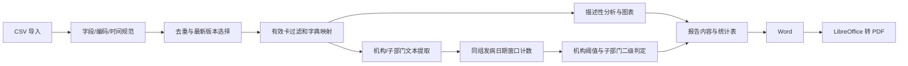

# 传染病疫情数据分析与暴发探测

面向监测数据日常整理、描述性分析与重点场所聚集线索筛查的 R Shiny 应用。将 CSV 导入、质量清洗、可视化、聚集预警和 Word/PDF 报告串成一次操作流程，帮助使用者从报卡数据定位需要人工核实的线索。

**当前为参赛演示版本；仓库中的病例数据完全合成。** 默认启动不需要真实监测文件。程序输出的是规则触发的“疑似聚集性疫情预警”，不是已经确认的暴发事件，也不是机器学习预测。

## 能做什么

| 功能 | 实现方式 |
| --- | --- |
| 数据导入与清洗 | 支持 UTF-8 / GB18030 CSV；校验必要字段；去除完全重复行、保留同卡最新版本，再剔除无效卡和无效发病日期 |
| 分析与展示 | 病种构成、时间趋势、年龄/性别、人群和地区分布；可替换人口数据，计算每 10 万人口病例率 |
| 重点场所聚集筛查 | 工作单位与住址分别提取机构及子部门；同地区代理、同机构、同原始病名的发病日期滑动窗口计数 |
| 一键报告 | 周报、月报、专题分析默认输出完整基础分析、图表、统计表和预警；生成可编辑 Word，配置 LibreOffice 后可直接导出 PDF |
| 可追溯结果 | 预警窗口、病例数量、子部门分布与关联卡片可供人工核实 |

## 三步启动

推荐先使用已经验证的 R 4.5.3 环境；其他 R 版本需要自行检查依赖兼容性。在 RStudio 中打开项目目录，或在该目录的终端执行：

```sh
Rscript scripts/install_dependencies.R
R -e "shiny::runApp('.', launch.browser = TRUE)"
```

首次运行只需安装依赖。之后直接执行第二条命令即可。也可以在 RStudio 中打开 `app.R`，点击 **Run App**。

默认加载 [`data/demo_surveillance.csv`](data/demo_surveillance.csv)。它包含 334 条完全合成记录，清洗后 330 条，用于观察去重、订正删除、无效日期与聚集识别效果。运行 `Rscript scripts/make_demo_data.R` 可按固定种子重新生成相同演示文件。

PDF 需要本机安装 LibreOffice 和可用中文字体。Word 不依赖 LibreOffice，也不需要 LaTeX。Linux 系统库、PDF 配置与云端发布详见 [部署说明](docs/DEPLOYMENT.md)。

## 一次演示怎么走

1. 打开应用，保留默认合成数据，查看总体疫情与清洗结果。
2. 打开重点场所预警，将发病日期范围设为 **2026-10-01 至 2026-10-08**，阈值设为 **3 例**，窗口为 **14 天**。
3. 可看到 3 个虚构机构的预警：演示晨光小学 6 例、演示星河幼儿园 6 例、演示云杉中学 4 例。其中前两个存在 3 例班级聚集，第三个各班分别 1 例，显示机构级聚集、子部门未达阈值。
4. 在“一键报告中心”选择周报、月报或专题、确定期间，下载 Word 或 PDF。月报可选择 2026 年 9 月。报告期间由本页选择，沿用左侧病种、管理级别、传播方式及统计时间口径；聚集线索固定按发病日期计算。

报告默认包含以下基础疫情分析，无需另行勾选内容：

- **总体疫情与分类构成**：病例、病种、地区及人口指标，管理级别与传播途径构成，病种排行及统计表；前3位病种分别分析时间、地区与人群分布。
- **时间分析**：每日病例曲线、周期汇总、病种时间分布和高峰解读。
- **地区分析**：地区病例数、每10万人口指标、行政区划地图、地区趋势与地区—病种分布；使用应用当前人口参数和已匹配地图。未确认报告期间数据完整时，人口指标标为已纳入病例人口比。
- **人群分析**：人群分类、性别、年龄组及年龄—性别分布，附图表与文字解读。
- **聚集预警与数据质量**：机构和班级/科室判定、窗口与病例数、规则及核查建议，清洗记录、缺失信息与统计局限。

没有地图时仍会生成地区统计表和图，并注明地图缺失；没有有效人口参数的地区不计算病例率。合成报告使用内置人口参数作演示，指标不反映真实疫情。`Rscript scripts/generate_demo_reports.R` 可一次生成三类 Word/PDF 样例；只读取随附的合成病例文件。

报告默认不把缺少历史记录解释为零病例，也不凭已有病例的最早/最晚日期推定数据完整。只有勾选完整性确认并填写经核实的数据覆盖期，且覆盖本期及对应比较期时，才计算环比/同比；零基数不显示无穷增长率。演示数据虽然包含历史样本，但并非连续完整监测，不能据此宣称完整覆盖。报告下载仅包含汇总信息：默认显示具体机构名称、班级或科室等子部门名称及各部门病例数；如需匿名报告，取消勾选“显示具体机构名称和子部门名称”。患者卡片、精确地址和关联标识始终不导出。

## 数据格式

上传病例文件采用 **CSV**。至少需要 `疾病名称` 与 `发病日期` 两列；只有能解析出有效发病日期且病种不为空的有效卡片才进入分析。可直接参考 [合成上传模板](data/demo_surveillance.csv)。

| 字段 | 用途与示例 |
| --- | --- |
| 卡片ID / 卡片编号 | 同卡多版本去重，优先使用 ID；示例为 `SYNTH-CLUSTER-0001` |
| 疾病名称 | 字典分类与探测分组，例如 `流行性感冒` |
| 发病日期 | 探测统一使用该口径，例如 `2026-10-01` |
| 订正终审时间 / 报告卡录入时间 | 选择同卡最新版本；例如 `2026-10-03 11:00:00` |
| 卡片状态 / 审核状态 / 删除时间与原因 | 判定是否排除已删除、退卡、作废、未纳入统计等记录 |
| 患者工作单位 | 如 `演示晨光小学三年级二班`，用于提取机构和子部门 |
| 现住详细地址 / 现住地址国标 | 地区匹配、住址场所识别和同名机构地域隔离 |
| 年龄 / 出生日期 / 性别 / 人群分类 | 人群分布；缺失值不自动猜测 |

缺失的非必要列会补为空值，但相应统计或预警功能可能无法形成结果。不同人使用不同卡片 ID 的重复报卡，目前不会自动识别为同一人。

真实业务数据可通过界面上传；如需本机启动即加载特定文件，可在启动前设置 `SURVEILLANCE_DATA_FILE` 为该文件路径。公开演示环境只使用合成数据。

## 技术实现与边界



- 前端与交互：`shiny`、`shinydashboard`、`DT`、`plotly`、`leaflet`。
- 数据处理与地理数据：`dplyr`、`readr`、`lubridate`、`stringr`、`sf`。
- 文档：`officer`、`flextable`、`ggplot2`、`ragg`；PDF 使用本机 LibreOffice 转换。

完整规则、窗口边界、实例与局限见 [暴发探测规则说明](docs/DETECTION_RULES.md)。目前没有时空扫描统计、CUSUM、机器学习或历史基线异常模型；没有给出经过现场验证的灵敏度、特异度或提前预警天数。默认“14 天 / 3 例”是可调整的演示筛查参数，并非适用于所有病种的统一判定标准。

地图文件不随公开材料包分发。无地图时仍可进行主要统计、地区表格、聚集探测与报告导出；自行补充经过授权且匹配的行政区划数据后可使用地图视图。内置人口与病种字典是项目配置，正式应用前应按地区、统计时点和业务规则更新。

## GitHub 互动和在线演示

**GitHub 仓库用于阅读源码、提交 Issue / Pull Request；在线使用需要另行部署 Shiny。** GitHub Pages 只托管静态页面，不能直接运行当前应用的 R 服务端。可选择 Posit Connect Cloud 或自有服务器。查看 [部署与发布](docs/DEPLOYMENT.md) 以及 [参与改进](CONTRIBUTING.md)。仓库附有问题反馈/功能建议表单，以及仅使用合成数据的 GitHub Actions 检查配置。工作流尚需首次推送后在云端验证。

先执行 `Rscript scripts/prepare_public_release.R`，再使用生成的 `output/public-release` 材料包。该包采用文件白名单，包含源码、合成数据、文档和部署配置，排除原始监测文件、办公资料、地图、备份及导出文件。不要将整个业务工作目录拖入 GitHub 上传。

尚未代作者选定许可证，也未创建外部仓库或公开服务。作者确认许可证并添加 `LICENSE` 后，再明确开放使用条款。公开代码与选择开源许可证是两个不同步骤。

## 文件导航

| 文件 | 职责 |
| --- | --- |
| `app.R` | Shiny 界面、筛选、图表与模块编排 |
| `data_preprocessing.R` | 导入、清洗、字典、人口和行政区划匹配 |
| `outbreak_detection.R` | 核心机构、子部门与规则窗口探测 |
| `report_generation.R` | 报告统计内容、Word 排版和 PDF 转换 |
| `report_analysis.R` | 完整基础疫情分析的统计表、地区人口指标与报告图表 |
| `report_module.R` | 报告页面与下载交互 |
| `scripts/` | 依赖安装、合成数据生成、公开材料打包 |
| `docs/` | 算法和部署说明 |
| `tests/` | 清洗、规则和报告关键行为验证 |
